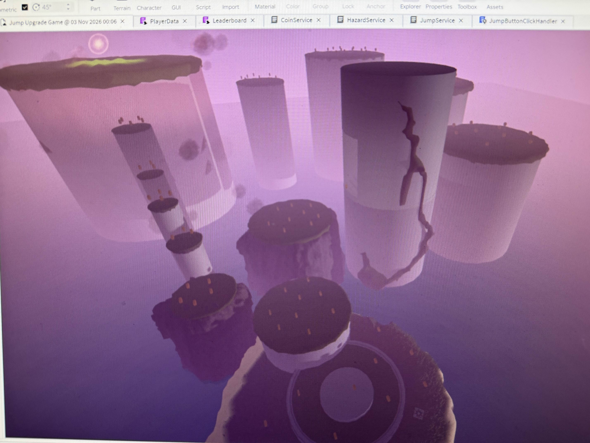
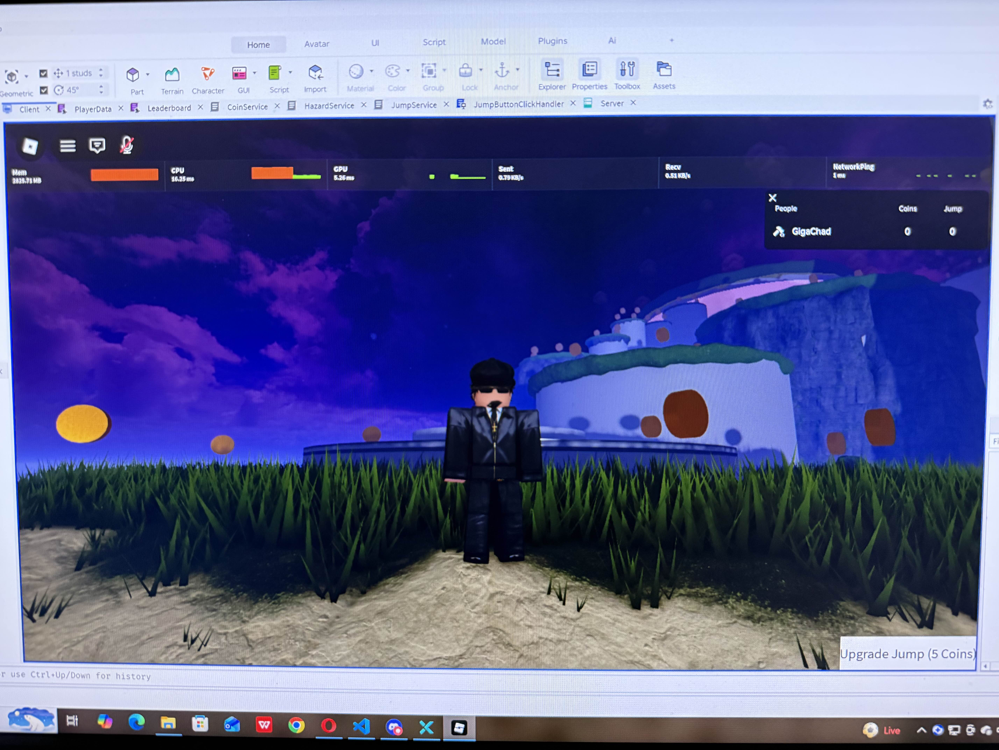

# Roblox Game - Lua Scripting

This repository contains the source code and scripts for a fully functional Roblox game. It was built to master game logic, event handling, and state management using Lua.

## Tech Stack
*   **Language:** Lua
*   **Engine:** Roblox Studio
*   **Concepts:** Object-Oriented Programming (OOP), Event Handling, Data Persistence.

## Core Features
*   **Coin Service:** A fully functional economy system where players collect coins that respawn on a cooldown timer.
*   **Player Data Persistence:** Saves player stats (like collected coins) so progress is not lost when they leave the game.
*   **Leaderboard System:** Tracks and displays the top players in the server.
*   **Hazard Service:** Implements environmental hazards that damage or reset the player, adding a risk/reward element to the gameplay.

## 3D Modeling & Environment Design
In addition to scripting the backend logic, I also designed the 3D environment and UI for this game using Roblox Studio. 

*(Screenshot of the level design)*

*(Screenshot of the player interface)*

## Play the Game
You can play the live version of this game on Roblox here: 
[Play on Roblox](https://www.roblox.com/games/127361872509777/Jump-Upgrade-Game)

## What I Learned
This project was my introduction to real game development. I learned how to structure a game using modular "Services" (CoinService, HazardService) rather than writing one massive script. I also learned how to handle server-side events and debug physical game mechanics in real-time.
